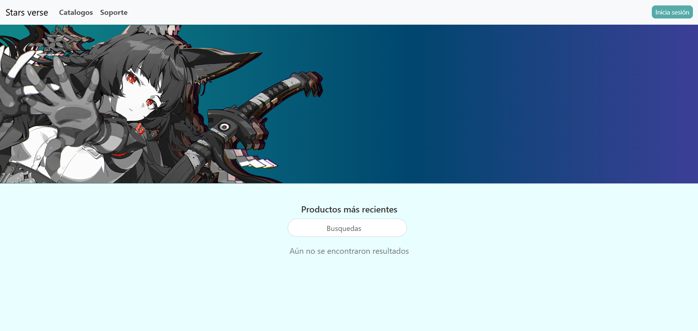
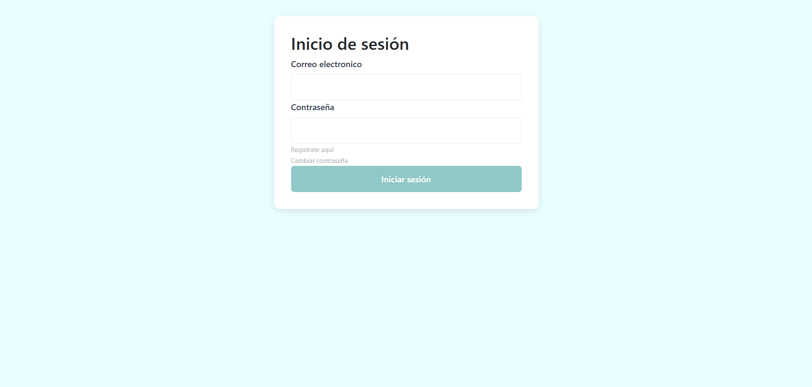
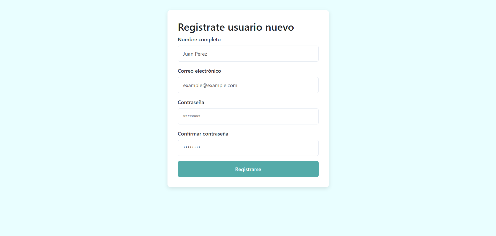

# Stars verse 🛒
Sistema de e-commerce con autenticación de usuarios, validación de formularios y diseño responsive.

## Caracteristicas principales
- Formularios de login y registro con validación
- Diseño responsivo con Bootstrap

## Vista previa 📷

### Home


### Inicio sesión


### Registro


## Mockup


## Requisitos 💻
- node.js >= 20.19.4
- Angular >= v17
- Navegador web 

## Instalación 🧩
```bash
1. Clone el repositorio
cd Starsverse
```
```bash
2. Instala las dependencias:
npm install
```
```bash
3. Iniciar servidor
ng serve
```
## Tecnologias utilizadas 👩‍💻
- Angular v20
- Boostrap v5.3.7
- Typescript
